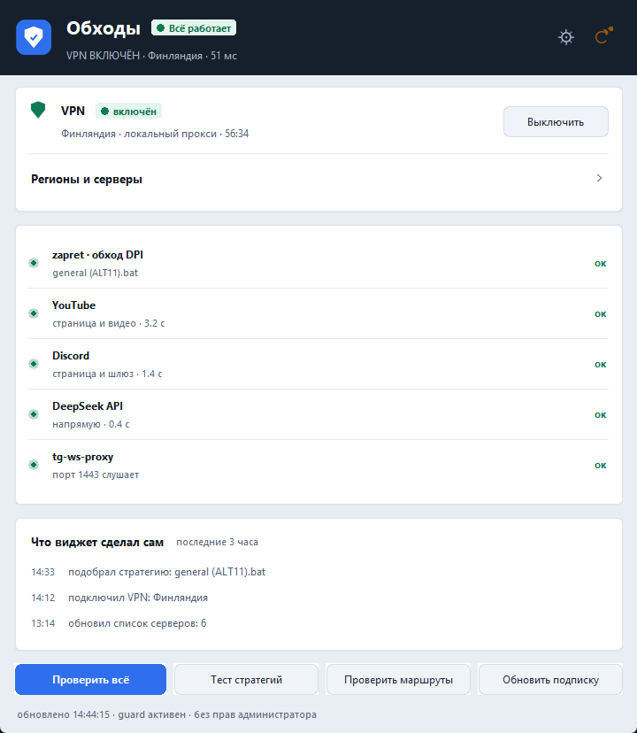

# Обходы (bypass-tray)

Приложение для Windows, которое держит открытыми YouTube, Discord, Telegram,
Instagram и другие заблокированные сервисы: поднимает ваш VPN-сервер на ядре
Xray, обходит DPI для YouTube и Discord и ускоряет Telegram. Живёт в трее,
показывает своё состояние одним значком и само лечит то, что отвалилось.



## Что делает приложение

- **VPN через вашу подписку.** Вставляете ссылку на подписку, выданную вашим
  VPN-провайдером, — приложение само получает список серверов, выбирает самый
  быстрый и поднимает локальный прокси на `127.0.0.1:10818`, прописывая его в
  систему. Российские сайты идут напрямую, заблокированные — через сервер.
- **Обход DPI для YouTube и Discord** через zapret: они открываются
  **напрямую**, без VPN, поэтому скорость не падает.
- **Telegram без тормозов** через локальный MTProto-прокси tg-ws-proxy.
- **Проверяет, что всё действительно работает:** настоящие запросы к YouTube,
  Discord, DeepSeek, Telegram и проверку туннеля через ваш сервер — раз в
  10 минут и по кнопке «Проверить всё».
- **Само лечится:** поднимает упавший прокси, переключает мёртвый сервер,
  перепроверяет маршруты. Всё, что сделало, пишет в журнал в панели.

[Тёмная тема](docs/img/panel-dark.png) · [Список серверов](docs/img/panel-servers.png) ·
[Настройки](docs/img/settings-light.png)

## Установка

1. **Скачайте** `bypass-tray-windows.zip` со страницы
   [Releases](../../releases/latest) и распакуйте в любую папку (не в
   `Program Files` — приложению нужно писать рядом с собой).
2. **Запустите `Обходы.exe`.** Python и что-то доустанавливать не нужно, всё
   внутри. Windows SmartScreen может предупредить, что издатель не подписан:
   «Подробнее» → «Выполнить в любом случае». Появится значок в трее.
3. **Вставьте свою подписку:** откройте панель (двойной клик по значку) →
   шестерёнка → «VPN и подписка» → вставьте ссылку на подписку → «Сохранить» →
   закройте настройки → «Подключить».

Через несколько секунд значок станет зелёным — значит туннель поднят и сервисы
отвечают. Повторно вводить подписку не нужно: она сохраняется и подхватывается
при следующем запуске.

> Ссылку на подписку выдаёт ваш VPN-провайдер (это обычный `https://…`, который
> открывается в браузере как список серверов). Своего сервера приложение не даёт.

## Свои конфиги

Подписка не обязательна: свой сервер вставляется в настройках
(«VPN и подписка» → «Свои конфиги») любым способом:

- текстом — одна или несколько ссылок `vless://`, `vmess://`, `trojan://`,
  `ss://`;
- base64-подпиской целиком;
- импортом из файла (`.txt`, `.conf`, `.json`, `.base64`);
- из буфера обмена одной кнопкой.

Под полем видно «Распознано: N». Свои ссылки и подписка дополняют друг
друга: если один источник отвалился, приложение работает на том, что есть.

## Что значат значки в трее

| Значок | Состояние | Что делать |
|---|---|---|
| 🟢 галочка | Всё работает | ничего |
| 🟠 «!» | Есть перебои: один сервис недоступен, zapret выключен (YouTube идёт через VPN) или отчёт устарел | заглянуть в панель, там написано что именно |
| 🔴 крест | Серьёзный сбой: не работает VPN, недоступен DeepSeek или сразу YouTube и Discord | «Проверить всё», затем «Подобрать лучший» сервер |
| ⚪ щит | VPN выключен | «Подключить», если нужен |
| 🕐 часы | Проверка ещё не проходила | подождать или нажать «Проверить всё» |

Пока идёт проверка, цвет не меняется — в подсказке просто написано
«проверяю…».

## Если что-то не работает

| Симптом | Причина | Что сделать |
|---|---|---|
| Значок серый, сайты не открываются | VPN не подключён | «Подключить» в панели |
| Значок оранжевый или красный | часть проверок не прошла | открыть панель: там по каждому сервису видно, что случилось |
| Не открывается YouTube | zapret остановлен | в панели у строки zapret нажать «Запустить» |
| Тормозит Telegram Desktop | не работает tg-ws-proxy | в панели у строки tg-ws-proxy нажать «Запустить» |
| Подключено, но сайты не грузятся | выбран мёртвый сервер | «Регионы и серверы» → «Подобрать лучший» |
| Просит права администратора | нужны для установки/перезапуска службы zapret и теста стратегий | согласиться один раз; обычная работа прав не требует |

## Требования

- Windows 10 или 11, 64-бит.
- Интернет. Права администратора — только для отдельных действий (см. выше).
- Настройки и журналы лежат в `%APPDATA%\bypass-tray\` (`config.json`,
  `health.json`, `activity.log`). Удалить приложение = удалить папку и значок
  из автозапуска.

## Возможности подробнее

- **Панель под новый макет.** Шапка с состоянием, карточка VPN (сервер,
  локальный прокси, аптайм, кнопка «Включить/Выключить»), раскрывающийся список
  «Регионы и серверы» с пометками `★` (лучший) и `●` (текущий), задержками и
  кнопками «Подобрать лучший» / «Обновить список». Ниже — строки сервисов,
  карточка обновлений и журнал «что приложение сделало само». Светлая и тёмная
  темы переключаются в настройках: авто, светлая, тёмная; контраст текста выдержан по WCAG AA.
- **Собственный клиент Xray.** Серверы из подписки и своих конфигов
  (`vless`, `vmess`, `trojan`, `ss`), проверка доступности, выбор самого
  быстрого, локальный прокси на `127.0.0.1:10818`. TUN не используется,
  поэтому zapret продолжает работать как обычно.
- **Надзиратель (guard).** Раз в `guard_minutes` (10 минут) поднимает
  tg-ws-proxy, при мёртвом туннеле переключает сервер, перепроверяет маршруты.
  UAC из фона не вызывает, живой туннель из-за аудита не перезапускает.
- **Аудит маршрутов.** Домены проверяются напрямую и через прокси, решение
  (`direct`/`proxy`) сохраняется в оверрайды; проверка раз в
  `route_audit_minutes` (60 минут).
- **Свои маршруты сайтов.** В настройках: домен или ссылка → «Напрямую» или
  «Через VPN». Своё правило важнее автоподбора и встроенных списков.
- **Список заблокированных сайтов.** Очищенный список Re:filter (81 тыс.
  доменов, MIT): заблокированное идёт через VPN, YouTube и Discord остаются под
  zapret.
- **Автозапуск, автоподключение, тихий режим.** Тумблеры в настройках; тихий
  режим убирает всплывающие уведомления, но значок всегда показывает настоящее
  состояние.

## Настроить дашборд

Настройки → «Дашборд»: у каждой проверки два тумблера — «Проверять» (входит в расчёт иконки) и «Показывать» (видна в панели). Скрытая, но проверяемая проверка продолжает влиять на состояние. Свои проверки — https (код ответа и текст в теле) или порт; до добавления адрес можно проверить командой `--check URL`.

## Благодарности и лицензии

Само приложение распространяется под MIT. Внутри — компоненты других авторов,
у каждого своя лицензия:

| Компонент | Что делает | Автор | Лицензия |
|---|---|---|---|
| [Xray-core](https://github.com/XTLS/Xray-core) | ядро VPN/прокси | команда XTLS (RPRX) | MPL-2.0 |
| [zapret](https://github.com/bol-van/zapret) | обход DPI (оригинал) | bol-van | MIT |
| [zapret-discord-youtube](https://github.com/Flowseal/zapret-discord-youtube) | Windows-сборка zapret и стратегии | Flowseal | MIT |
| [tg-ws-proxy](https://github.com/Flowseal/tg-ws-proxy) | прокси для Telegram | Flowseal | MIT |
| [Re:filter-lists](https://github.com/1andrevich/Re-filter-lists) | список заблокированных доменов | Andrevich | MIT |

Тексты лицензий лежат в [data/licenses/](data/licenses/) и входят в релизный
архив; подробности — в [THIRD_PARTY.md](THIRD_PARTY.md).

## Для разработчиков

```powershell
python -m venv .venv; .venv\Scripts\pip install -r requirements.txt -r requirements-build.txt
$env:PYTHONPATH='src'; .venv\Scripts\python.exe -m bypass_tray     # запуск из исходников
$env:PYTHONIOENCODING='utf-8'; .venv\Scripts\python.exe tests\smoke_test.py   # 417 проверок
build.bat                                                          # сборка dist\Обходы
```

Архитектура, конфиг и спецификация — в [`docs/`](docs/): `ARCHITECTURE.md`,
`CONFIG.md`, `SPEC.md`. Релиз собирается GitHub Actions по тегу `v*`.

> Это Windows-аналог Linux-виджета «Обходы» из проекта
> `VPN-TGWSProxy-Zapret-orchestrate`. Бэкенд другой: на Windows нет nfqws,
> systemd и т.п.
