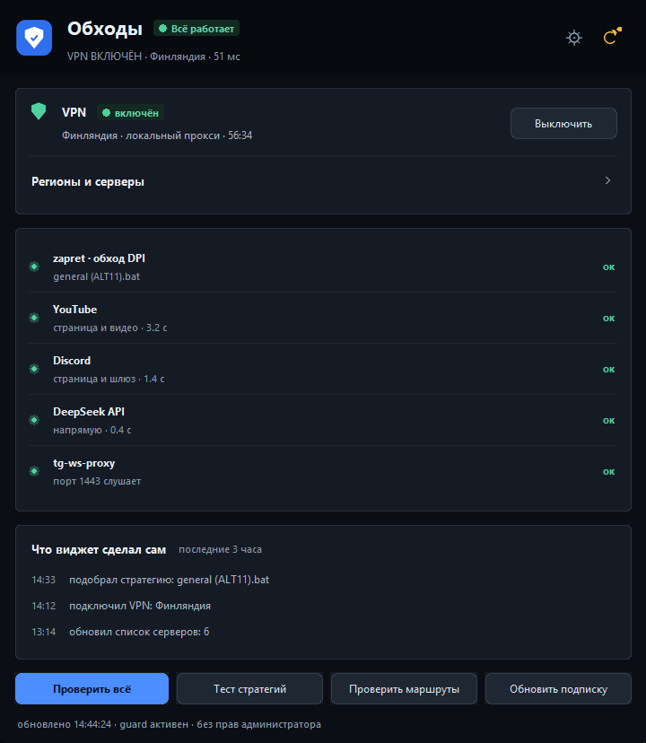
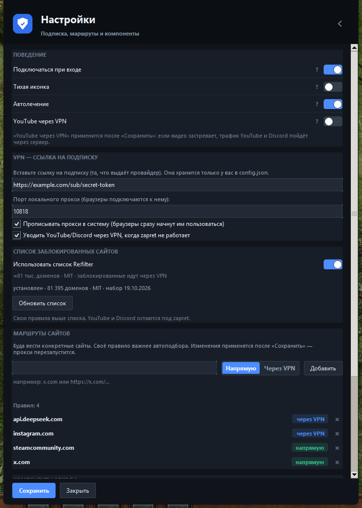

# bypass-tray

Windows-трей-приложение, которое собирает в одном месте состояние всех «обходов»
на ПК, позволяет управлять ими и оповещает об обновлениях:

- **Xray** — собственный VPN-клиент на ядре Xray: через него идут только
  заблокированные сервисы и западные соцсети;
- **zapret** (`winws.exe`, `general*.bat`) — обход DPI для YouTube и Discord
  (они идут **напрямую**, не через VPN);
- **tg-ws-proxy** — локальный MTProto-прокси для Telegram Desktop.

Состояние иконки в трее: «занято» во время действий, «сбой» и «требует
внимания» по результату проверки, щит при выключенном VPN, галочка когда всё
работает. При включённой тихой иконке состояние «всё работает» рисуется серым.
По клику открывается панель.



[Светлая тема](docs/img/panel-light.png) · [Список серверов](docs/img/panel-servers.png)

> Это Windows-аналог Linux-виджета «Обходы» из проекта
> `VPN-TGWSProxy-Zapret-orchestrate`. Бэкенд другой: на Windows нет nfqws,
> systemd и т.п.

## Возможности

- **Панель под новый макет.** Шапка с состоянием, карточка VPN (сервер,
  локальный прокси, аптайм, кнопка «Включить/Выключить»), раскрывающийся список
  «Регионы и серверы» с пометками `★` (лучший) и `●` (текущий), задержками и
  кнопками «Подобрать лучший» / «Обновить список». Ниже — пять строк сервисов,
  карточка обновлений, журнал «что виджет сделал сам», тумблеры «Подключаться
  при входе», «Тихая иконка», «Автолечение» и кнопки «Проверить всё», «Тест
  стратегий», «Проверить маршруты», «Обновить подписку». Светлая и тёмная темы
  выбираются по системе; системная рамка окна окрашена под шапку.
- **Проверки состояния (health).** Настоящие запросы: zapret, YouTube
  (страница и CDN видео), Discord (страница и шлюз), DeepSeek API, Telegram Bot
  API через прокси, порт tg-ws-proxy и проверка туннеля `xray.verify()` через
  сервер. Пробы идут параллельно, результат кэшируется. Запускаются раз в
  `health_minutes` (10 минут) и по кнопке «Проверить всё».
- **Собственный клиент Xray.** Берёт серверы из вашей подписки, проверяет
  доступность, выбирает самый быстрый и поднимает локальный прокси на
  `127.0.0.1:10818`. **Права администратора не нужны**, TUN не используется,
  `zapret` продолжает работать как обычно. Российские сервисы идут напрямую,
  заблокированные — через сервер; прокси прописывается в систему.
- **Надзиратель (guard).** Раз в `guard_minutes` (10 минут) поднимает
  tg-ws-proxy, при мёртвом туннеле переключает сервер, перепроверяет маршруты.
  UAC из фона не вызывает и из-за аудита маршрутов живой туннель не
  перезапускает; свои действия пишет в журнал.
- **Аудит маршрутов.** Домены проверяются напрямую и через прокси, решение
  (`direct`/`proxy`) сохраняется в оверрайды. Проверка идёт раз в
  `route_audit_minutes` (60 минут). Кнопка «Проверить маршруты» после
  подтверждения перезапускает Xray, чтобы применить маршруты сразу.
- **Свои маршруты сайтов.** В настройках можно добавить домен или ссылку и
  выбрать «Напрямую» или «Через VPN». Правило переключается одним кликом,
  удаляется крестиком; своё правило важнее автоподбора и встроенных списков.
- **Список заблокированных сайтов.** В поставке очищенный список Re:filter
  (81 тыс. доменов, MIT): заблокированное идёт через VPN, YouTube и Discord
  остаются под zapret, свои правила и аудит — выше списка.
- **Память стратегии zapret по сети.** Ключ сети — MAC шлюза, иначе адрес
  шлюза, иначе SSID. После успешного автоподбора стратегия запоминается для
  текущей сети, а при смене сети (проверка раз в минуту) сохранённая стратегия
  применяется автоматически.
- **Определение стратегии.** Какой `general*.bat` сейчас работает — по
  отпечатку опций `--dpi-desync*`. Для установки службой аргументы читаются из
  реестра, права администратора не нужны.
- **Автоподбор стратегии zapret.** Перебирает `general*.bat`, реально проверяет
  YouTube/Discord и ставит лучшую в службу (один запрос UAC). Команда `winws`
  берётся из самого `.bat`, поэтому воспроизводится точно.
- **Обновления.** zapret, tg-ws-proxy и Xray-core из GitHub Releases. Кнопка
  «Обновить всё» обновляет все три компонента; загрузки атомарные (временный
  файл/папка, при обрыве старая копия остаётся). Версия виджета читается из
  `pyproject.toml` (`updates.widget_version()`); сам виджет себя не обновляет.
- **Поведение.** Тихая иконка (без авто-уведомлений), автозапуск ярлыком в
  папке «Автозагрузка», автоподключение при входе.
- **Надёжные записи.** Конфиг, состояние и служебные файлы пишутся атомарно
  (временный файл + `os.replace`). Битый `config.json` переименовывается в
  `config.json.bak-<время>` и не перезаписывается — настройки не теряются.

## Установка

Требуется Python 3.10+ (при установке отметьте «Add Python to PATH»).

1. Скачайте репозиторий и распакуйте.
2. Запустите **`setup.bat`** — один раз, больше ничего не нужно.

`setup.bat` создаст окружение, поставит зависимости, **скачает zapret и
tg-ws-proxy из официальных релизов**, включит автозапуск и запустит виджет
в трее. Останется открыть «Настройки» и вставить ссылку на подписку VPN.

Дальше приложение стартует само при входе в систему (`run.bat` в автозапуске).

### Где что лежит

| Что | Куда |
|---|---|
| Приложение | папка, куда распакован репозиторий |
| zapret | `%LOCALAPPDATA%\bypass-tray\zapret` |
| tg-ws-proxy | `%LOCALAPPDATA%\bypass-tray\tgws` |
| Ядро Xray | `<проект>\bin` (своё или скачивается с официального релиза) |
| Настройки и служебные файлы | `%APPDATA%\bypass-tray` |

## Настройки

Кнопка-шестерёнка в шапке панели (или пункт «Настройки…» в меню трея).
Настройки открываются внутри панели отдельной страницей с кнопкой «Назад»;
второе окно больше не создаётся.

- **«Поведение»** — три тумблера: «Подключаться при входе», «Тихая иконка»,
  «Автолечение». Применяются сразу, без кнопки «Сохранить».
- **Ссылка на подписку VPN** — то, что выдаёт провайдер; хранится только
  локально, в репозиторий не попадает.
- Порт локального прокси и системный прокси.
- Резервный режим для YouTube/Discord.
- **«Маршруты сайтов»** — добавьте домен или ссылку, выберите «Напрямую» или
  «Через VPN» (Enter в поле тоже добавляет; кириллические домены переводятся
  в punycode). Правила видны списком: путь переключается кликом по плашке,
  правило удаляется крестиком. Своё правило важнее автоподбора. Изменения
  применяются после «Сохранить» — прокси перезапустится. Старые списки
  `xray_direct_domains`/`xray_extra_domains` при первом чтении конфига
  переносятся в `xray_routes` и больше не используются.
- **«Установить обходы»** — скачивает zapret и tg-ws-proxy, не выходя из окна.
- Пути к zapret и tg-ws-proxy (заполняются автоматически).



После «Сохранить» запущенный прокси перезапускается последовательно
(`stop` → `start`), чтобы новые настройки вступили в силу.

## Список заблокированных сайтов

В поставке лежит очищенный список доменов, заблокированных в РФ, в формате
geosite:

- **Источник:** [1andrevich/Re-filter-lists](https://github.com/1andrevich/Re-filter-lists),
  категория `REFILTER`;
- **≈81 тыс. доменов** (в файле 81 395 записей, исходный список — 81 061),
  набор от 19.10.2026, лицензия MIT
  (`data/LICENSE-refilter.txt`);
- файл `data/geosite-refilter.dat` при первом запуске копируется в `bin`
  рядом с ядром, в конфиг добавляется правило
  `ext:geosite-refilter.dat:REFILTER` (через VPN);
- **включён по умолчанию**; отключить или обновить можно в «Настройках» →
  «Список заблокированных сайтов» (кнопка скачивает свежий релиз, проверяет
  файл разбором GeoSiteList и `xray.exe -test`, затем атомарно заменяет);
- если каталога `data/` в сборке нет, список может скачаться при первом
  подключении (не чаще раза в час); обрезанный/битый файл не принимается;
- **YouTube и Discord** остаются напрямую под zapret, пока он работает;
  в резервном режиме уходят в туннель. Свои правила и аудит direct важнее
  списка;
- в исключения системного прокси список не добавляется — он работает только
  внутри Xray.

Подробности — [data/README.md](data/README.md), лицензии сторонних
материалов — [THIRD_PARTY.md](THIRD_PARTY.md).

## Если YouTube застревает

Симптом: ролик играет, потом уходит в бесконечную загрузку, обновление
страницы помогает. Это похоже на DPI-троттлинг TCP (QUIC браузер не
использует): страница и первые секунды открываются, потом поток «залипает».
Полной гарантии обхода нет — DPI меняется, сервер может быть медленным.

Что делает виджет:

- Когда YouTube/Discord идут **напрямую** (zapret работает, режим VPN для них
  выключен), их домены добавляются в исключения системного прокси. Браузер
  соединяется с YouTube сам, без лишнего хопа через локальный Xray; zapret
  обрабатывает эти TCP-соединения как обычно.
- Если в «Настройках» → «Поведение» включить **«YouTube через VPN»** (или
  пункт меню трея), YouTube и Discord пойдут через сервер, а из исключений
  прокси их домены убираются. Проверка health в этом режиме тоже идёт
  через прокси и не показывает «сбой» из-за закрытого прямого маршрута.
  Это обход троттлинга, но скорость зависит от сервера. Настройка
  применяется по «Сохранить» и перезапускает прокси.
- **«Тест стратегий»** теперь проверяет реальную загрузку: качает до 512 КБ
  на каждую цель и засчитывает стратегию только при ответе и не менее 64 КБ
  данных. Контрольный адрес проверяется на доступность. Тест ручной, требует
  UAC и занимает несколько минут.

Порядок действий при застревании:

1. Включить «YouTube через VPN», сохранить настройки (прокси перезапустится).
2. Если не помогло — «Тест стратегий» и выбрать стратегию с лучшей загрузкой.
3. Обновить страницу YouTube.

Настройку можно выключить в любой момент; тогда YouTube снова пойдёт напрямую
под zapret.

## Командная строка

Диагностика без графики:

```bat
.venv\Scripts\python.exe -m bypass_tray --status
.venv\Scripts\python.exe -m bypass_tray --health
.venv\Scripts\python.exe -m bypass_tray --route-audit [--apply]
.venv\Scripts\python.exe -m bypass_tray --updates
```

- `--status` — JSON со статусами zapret, tg-ws-proxy и Xray;
- `--health` — JSON проверки всех пунктов с итоговым `verdict`;
- `--route-audit` — JSON аудита доменов; с `--apply` результат сохраняется в
  оверрайды (без перезапуска прокси);
- `--updates` — JSON сравнения компонентов с последними релизами.

Служебные режимы `--setup` (установка и запуск) и `--sweep-strategies`
(перебор стратегий под UAC) используются `setup.bat` и кнопкой «Тест
стратегий».

## Проверка

```bat
.venv\Scripts\python.exe tests\smoke_test.py
```

По умолчанию набор работает офлайн: сетевые проверки (GitHub, подписка,
замер связи) помечаются `SKIP` и включаются переменной
`BYPASS_TRAY_LIVE=1`. Проверяются пути, схема статусов, определение стратегии,
иконки, меню, сборка панели на фейковом контроллере, атомарная запись,
маршруты и конфиг. Обход при этом не останавливается и не запускается.

## Настройка

При первом запуске создаётся `%APPDATA%\bypass-tray\config.json`; пути
(`zapret_dir`, `tgws_exe`) определяются автоматически по типовым
местам, но их можно вписать вручную. Полное описание — [docs/CONFIG.md](docs/CONFIG.md).

## Документация

- [docs/SPEC.md](docs/SPEC.md) — полное функциональное описание, критерии
  приёмки и оставшиеся задачи.
- [docs/ARCHITECTURE.md](docs/ARCHITECTURE.md) — модули, потоки, схема данных.
- [docs/CONFIG.md](docs/CONFIG.md) — конфиг, служебные файлы и пути.
- [CHANGELOG.md](CHANGELOG.md) — история версий.

## Сборка .exe

Готовая сборка — ONEDIR (без onefile), запускается быстро и не распаковывается
во временную папку:

```
python -m pip install -r requirements.txt -r requirements-build.txt
python packaging\make_icon.py
python -m PyInstaller --clean --noconfirm packaging\bypass-tray.spec
```

Перед сборкой `bin/` должен быть заполнен (`xray.exe`, `geoip.dat`,
`geosite.dat`) — запустите приложение или `xray.ensure_core()`. `data/`
хранится в репозитории. Сборка не подписана — SmartScreen может предупредить.

Результат — `dist\Обходы\Обходы.exe` и папка рядом (`bin`, `data`, DLL).
В диспетчере задач процесс называется **Обходы**, иконка — щит приложения.
`bin`/`data` лежат рядом с exe (в spec включён `contents_directory="."`),
поэтому `xray.bin_dir()` и `blocked.packaged_path()` работают без скачивания
ядра и списка. `run.bat` запускает exe, если он собран, иначе — `pythonw`.
Требуется PyInstaller ≥ 6; на Python 3.14 проверено, при проблемах —
отдельный `.venv-build` на Python 3.12.

## Статус

Версия **0.6.3** (26.10.2026). Развёрнуто и проверено на текущей машине:
VPN работает на собственном ядре Xray, сплит-туннель задан правилами
маршрутизации; дымовой набор — 381 проверка, офлайн-часть проходит без сети.

Интерфейс работает без анимаций: настройки, секция серверов и тумблеры
переключаются сразу, без промежуточных кадров.

Туннель проверяется раз в 60 с (3 неудачи подряд, запрос на `api.telegram.org`);
после автоматической смены сервера — кулдаун 10 минут. Сервер меняет только
эта проверка, `guard` её не дублирует — иначе частые перезапуски Xray рвали
соединения YouTube.

Жёсткие ограничения, которые не меняются:

- **TUN на Windows не используется** — он конфликтует с zapret (WinDivert).
  VPN — только локальный прокси `127.0.0.1:10818`.
- **sing-box и nfqws отсутствуют**: работают только ядро Xray и `winws.exe`.
- **Сам виджет себя не обновляет** — обновляются компоненты обхода, а новую
  версию виджета ставят из репозитория вручную.
- **Single-instance**: GUI-запуск держит мьютекс
  `Local\Blazeeers.BypassTray`; второй экземпляр показывает «Обходы уже
  запущены» и выходит.

### Развёртывание на этой машине

| Что | Значение |
|---|---|
| Проект | `F:\Plugins\bypass-tray` |
| Проверка статусов | `.venv\Scripts\python.exe -m bypass_tray --status` |
| Проверки | `.venv\Scripts\python.exe tests\smoke_test.py` |
| Запуск | `run.bat` (или ярлык в `shell:startup`) |
| zapret | `C:\Program Files\Zapret` — **служба** `zapret` |
| Xray | ядро `<проект>\bin\xray.exe`, прокси `127.0.0.1:10818` |
| tg-ws-proxy | `C:\Users\<имя>\Desktop\TgWsProxy_windows.exe` |
| Автозапуск | ярлык `bypass-tray.lnk` в папке `shell:startup` |

Подробности и особенности службы zapret — в [docs/CONFIG.md](docs/CONFIG.md).

### Что требует прав администратора

Приложение работает и без прав администратора, но управление **службой**
zapret (`sc stop/start`, смена стратегии) и автоподбор требуют UAC: при нажатии
кнопки появится системный запрос. Если запрос отклонить, статусы продолжат
обновляться, а действие просто не выполнится. Надзиратель и панель сами UAC
не вызывают.

## Лицензия

MIT (см. [LICENSE](LICENSE)).
